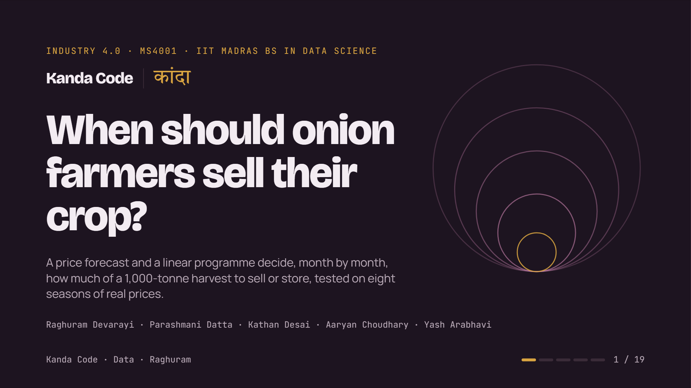
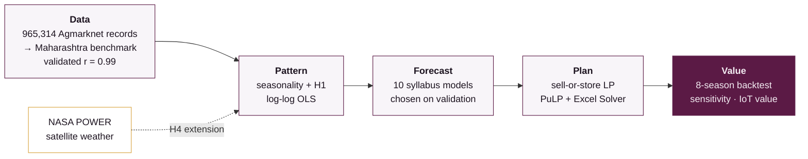
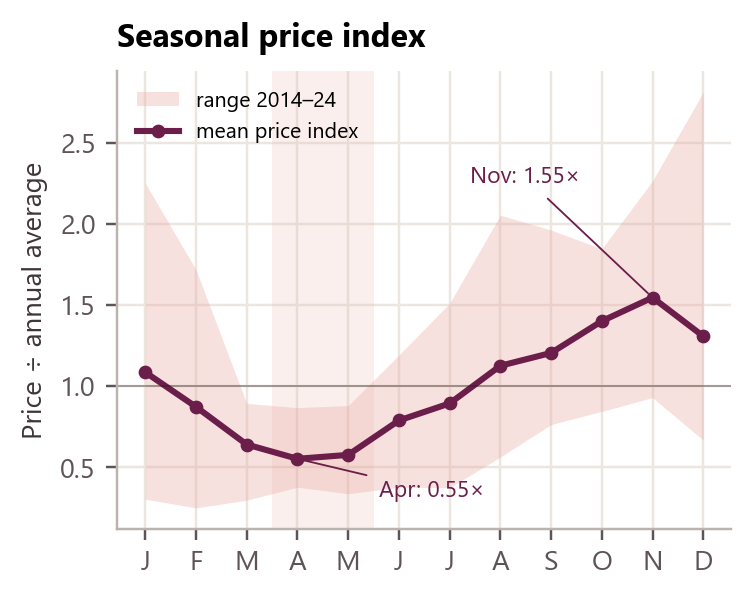
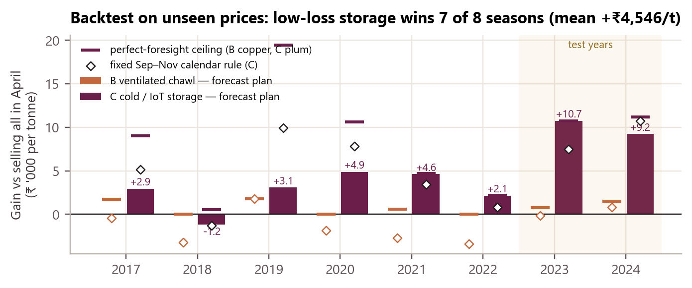
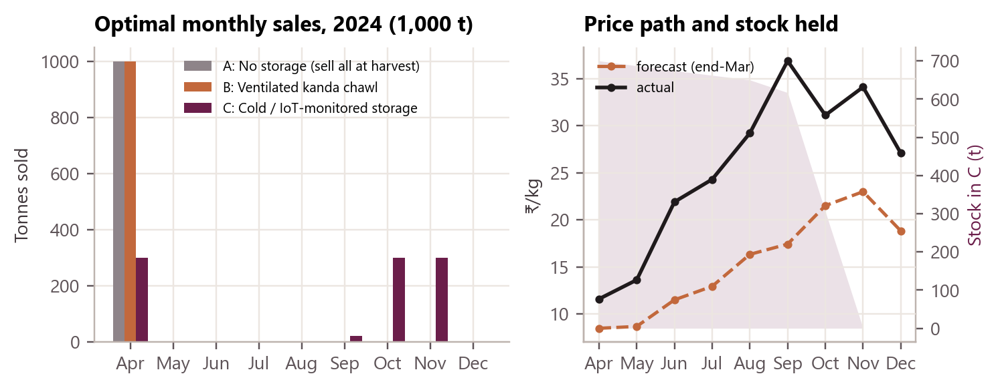
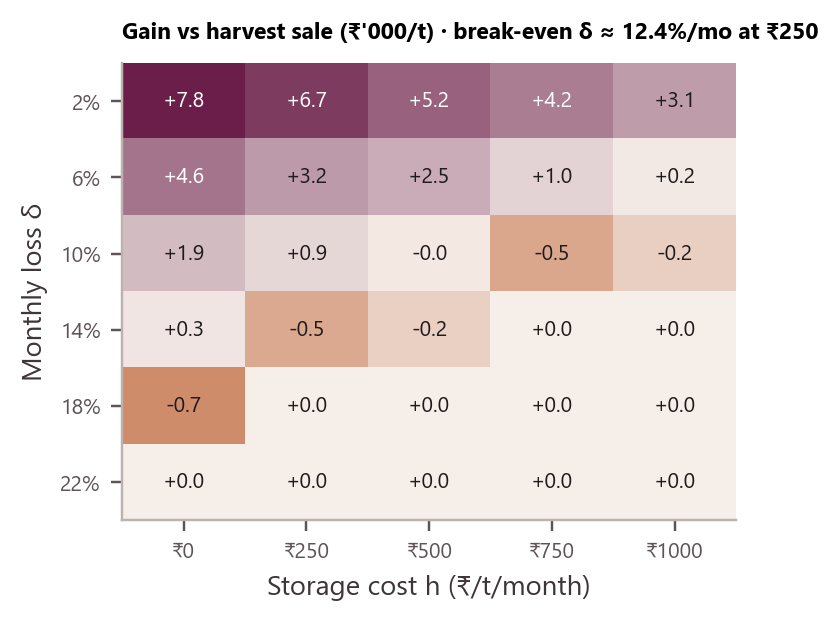
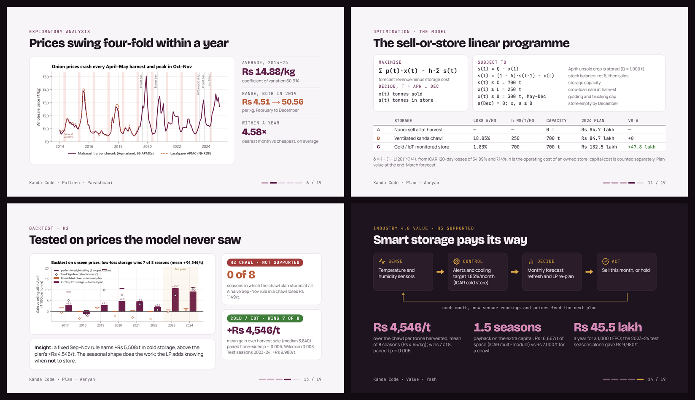

<div align="center">

<a href="https://23f2003700.github.io/Kanda-Code/"></a>

# Kanda Code · कांदा

### When should onion farmers sell their crop?

A price forecast and a linear programme decide, month by month, how much of a 1,000-tonne onion harvest to sell or store,<br>tested on eight seasons of real prices the model never saw.

**Industry 4.0 (MS4001) · IIT Madras BS in Data Science · Team Kanda Code**

[](https://23f2003700.github.io/Kanda-Code/)
[](https://www.youtube.com/watch?v=mao4kfn39vw)
[](report/KandaCode_Final_Report.pdf)
[](notebooks/KandaCode_Analysis.ipynb)


</div>

---

## Deliverables

| | What | Where |
|---|---|---|
| 🎞️ | **Presentation** (19 slides, 15 min, speaker notes) | **[23f2003700.github.io/Kanda-Code](https://23f2003700.github.io/Kanda-Code/)** · PDF: [`presentation/Kanda_Code_Deck.pdf`](presentation/Kanda_Code_Deck.pdf) |
| ▶️ | **Recorded explanation** | [YouTube](https://www.youtube.com/watch?v=mao4kfn39vw) |
| 📄 | **Summary report** (3 pages, Times New Roman 11 pt) | [`report/KandaCode_Final_Report.pdf`](report/KandaCode_Final_Report.pdf) · editable [`.docx`](report/KandaCode_Final_Report.docx) |
| 📓 | **Analysis notebook** (executed, narrated) | [`notebooks/KandaCode_Analysis.ipynb`](notebooks/KandaCode_Analysis.ipynb) |
| 📊 | **Excel LP model** (live Solver) | [`excel/KandaCode_LP_Model.xlsx`](excel/KandaCode_LP_Model.xlsx) |
| 🧮 | **Source code** (one analysis module + builders) | [`src/`](src/) |
| 👥 | **Individual contribution sheet** (20% × 5) | [`submission/Kanda_Code_Individual_Contribution.xlsx`](submission/Kanda_Code_Individual_Contribution.xlsx) |
| 📝 | Approved proposal · methodology · data dictionary · every quotable number | [`docs/`](docs/) |

> **Presenting from the web deck:** `→` / `Space` next · `←` back · `F` full screen · `N` speaker notes with a 15-minute timer · `O` all slides · `Ctrl+P` saves a one-slide-per-page PDF. Deep links work: [`#/12`](https://23f2003700.github.io/Kanda-Code/#/12) opens slide 12.

---

## The question

**कांदा** (kāndā) is Marathi for onion. An onion is rings, and this project peels a farmer's selling decision one layer at a time: **data → pattern → forecast → plan → value.**

Onion prices at the April rabi harvest sit at about **0.55×** the year's average and climb to about **1.55×** by November. Farmers still sell most of the crop at the low, because stored onions rot. We built a decision model for a **farmer producer organisation (FPO) holding 1,000 t in April**:

1. **Forecast** monthly prices April–December from an end-of-March origin.
2. **Optimise** with a linear programme: how many tonnes to sell each month, net of storage loss and storage cost.
3. **Backtest** every plan on prices the model never saw (8 seasons, 2017–2024; 2023–24 are the pre-registered test seasons).



The same LP is solved for three storage scenarios. The colour code is the same in every chart, slide and table:

| Scenario | Storage | Monthly loss δ | Cost h (Rs/t/month) | Colour |
|---|---|---|---|---|
| **A** | None: sell everything at harvest | – | – | slate |
| **B** | Ventilated kanda chawl | 18.05% (ICAR: 54.89% in 120 days) | 250 | copper |
| **C** | Cold / IoT-monitored storage | 1.83% (ICAR-DOGR: 7.14% in 120 days) | 700 | plum |

### The linear programme

$$\max \sum_{t=\text{Apr}}^{\text{Dec}} p_t\,x_t \;-\; h\sum_t s_t$$

subject to $s_1 = Q - x_1$, $\;s_t = (1-\delta)\,s_{t-1} - x_t$ (stock balance with perishability), $\;s_t \le C = 700$ t, $\;x_1 \ge L = 250$ t (crop-loan sale), $\;x_t \le U = 300$ t for May–Dec (grading and trucking), $\;s_{\text{Dec}} = 0$, $\;x, s \ge 0$, with $Q = 1{,}000$ t and $\delta = 1-(1-L_{120})^{1/4}$.

---

## Headline results

| Layer | Finding | Key number |
|---|---|---|
| Data | Lasalgaon APMC has **0 rows** in the main dataset, so we built a Maharashtra arrival-weighted benchmark (85,346 clean market-days, 96 markets) and validated it | r = 0.9896 vs NHRDF Lasalgaon (66 months); r = 0.90 vs 19 reported 2020–24 prices |
| Pattern | On average prices bottom in April–May and peak in November (seasonal index Apr 0.553, Nov 1.546) | Nov price > Apr price in 11 of 11 years; median Apr→Nov rise 148.3%; the single best month varies (Nov in 5 of 11 years) |
| **H1**: arrivals push prices down | **Supported, as an association** | β = −0.442 (log-log, month + year dummies), one-sided HAC p = 0.0066 |
| Forecast | Regression with trend + month dummies, chosen on validation seasons 2019–22 | Validation MAPE 36.94%; test MAPE 29.5%; bias −17.11%; direction hits 93.75% |
| **H2**: an optimised plan with ventilated-chawl storage beats harvest sale | **Not supported** at ICAR's loss rate | Optimiser never stores (gain Rs 0/t); a fixed Sep–Nov chawl rule loses Rs 1,149/t on average; break-even loss ≈ 12.4%/month |
| **H3**: low-loss storage raises net revenue per tonne by a material margin over ventilated storage | **Strongly supported** | C beats B (whose plan equals harvest sale) in 7 of 8 seasons; mean +Rs 4,546/t (median 3,840); one-sided paired t p = 0.0062, Wilcoxon p = 0.0078 |
| Value | Low-loss storage repays its extra capital quickly at the base cost | ≈ Rs 45.5 lakh a year for a 1,000 t FPO; extra capital pays back in 1.49 seasons (0.15 at Rs 8,000/t, 6.62 at Rs 50,000/t) |
| **H4** (extension): heavier Sep+Oct rain is followed by a bigger post-harvest price rise | **Weakly supported, suggestive** (NASA POWER satellite rain, 29 seasons 1996–2024) | β ≈ +20% bigger rise per 100 mm, p = 0.0361 (robust 0.0025), R² = 0.153; dropping 2005, 2018 or 2019 lifts p above 0.05 |
| Real-time rain feed (extension) | A 1 November re-plan with the rain signal changes nothing | Rs 0/t for B and C: the handling cap U = 300 t binds (shadow price +Rs 6,526 per t/month in 2024) |
| Value of loss information (extension) | Measuring the store pays when the price forecast is good, and most before the season | Chawl measured at 8%/month: Rs 2,200/t; cold store with accurate prices: sensing worth Rs 545–746/t at 8–15%/month loss |

Every quotable number lives in [`docs/KEY_NUMBERS.md`](docs/KEY_NUMBERS.md), generated from [`outputs/results.json`](outputs/results.json).

**The Industry 4.0 message.** The value lies in cutting monthly storage loss (sensors, controlled atmosphere, monitoring) and in data-driven timing. Every percentage point of monthly loss has a rupee price in the sensitivity grid.

<table>
<tr>
<td width="50%"><br><sub><b>Seasonality.</b> Prices bottom at the April harvest and peak in November.</sub></td>
<td width="50%"><br><sub><b>Backtest.</b> Cold/IoT storage beats harvest sale in 7 of 8 unseen seasons; the chawl plan never stores.</sub></td>
</tr>
<tr>
<td width="50%"><br><sub><b>2024 plan.</b> C holds 700 t and sells in Sep–Nov; A and B sell everything in April.</sub></td>
<td width="50%"><br><sub><b>Sensitivity.</b> Storage pays only below about 12.4% loss a month at Rs 250/t/month.</sub></td>
</tr>
</table>

<div align="center"><a href="https://23f2003700.github.io/Kanda-Code/"></a><br><sub>From the <a href="https://23f2003700.github.io/Kanda-Code/">web presentation</a>.</sub></div>

---

## Repository map

```
Kanda-Code/
├── README.md
├── requirements.txt
├── presentation/
│   ├── Kanda_Code_Deck.pdf              the 19-slide deck as PDF (one slide per page)
│   ├── PRESENTATION_SCRIPT.md           15-minute speaking script: order, presenter, words and timing per slide
│   ├── slides/                          deck source: one 1920×1080 HTML slide per file + deck.json (order, presenters)
│   ├── player_template.html             web player: scaling, navigation, notes, timer, overview, print
│   └── web/                             built site served by GitHub Pages (python src/build_presentation.py)
├── report/
│   ├── KandaCode_Final_Report.pdf       the 3-page summary report (9 mandatory sections)
│   ├── KandaCode_Final_Report.docx      editable source
│   └── fig_report_*.png, mark_rings.png figures drawn at print size for the report
├── notebooks/
│   └── KandaCode_Analysis.ipynb         executed notebook: the same functions, top to bottom, with narration
├── excel/
│   └── KandaCode_LP_Model.xlsx          live Solver model (README, LP_Model, Scenarios, Prices, Data_Monthly,
│                                        Backtest, Sensitivity, H1_Regression); Solver pre-configured
├── src/
│   ├── kandacode.py                     ALL analysis logic: cleaning, EDA, H1, 10 forecast models, LP, backtest,
│   │                                    sensitivity, IoT value, NASA POWER weather (H4), value of information
│   ├── run_all.py                       runs the full pipeline; writes outputs/ and data/processed/ (~5 min)
│   ├── fetch_nasa_power.py              re-downloads NASA POWER weather for Lasalgaon (free, no key)
│   ├── viz.py                           draws figures f1–f11 from results.json
│   ├── build_excel.py                   builds the Excel Solver model
│   ├── build_notebook.py                builds the narrated notebook
│   ├── make_key_numbers.py              writes docs/KEY_NUMBERS.md from results.json
│   ├── build_report.py                  builds the report (DOCX via python-docx, PDF via docx2pdf + MS Word)
│   └── build_presentation.py            builds the web deck in presentation/web/
├── data/
│   ├── raw/
│   │   ├── onion_2014_2024.parquet      main dataset, 113 MB → download from the v1.0 release (see below)
│   │   ├── nhrdf/                       NHRDF Lasalgaon monthly price + arrivals, 1996-01 to 2019-06
│   │   └── nasa_power/                  NASA POWER monthly weather at Lasalgaon (20.15°N 74.23°E), 1996–2024
│   ├── processed/                       written by run_all.py (never edited by hand)
│   │   ├── maharashtra_onion_monthly.csv   THE analysis series: 132 months, arrival-weighted modal price
│   │   ├── maharashtra_onion_daily.csv     3,972 trading days, for the H1 daily sign-check
│   │   ├── nasik_apmc_monthly.csv          Nasik APMC alone: robustness market
│   │   ├── lasalgaon_nhrdf_monthly.csv     NHRDF series, tidied
│   │   └── lasalgaon_nasa_power_monthly.csv  NASA POWER weather + monthly rain (H4)
│   └── validation/
│       └── lasalgaon_reported_prices_2020_2024.csv   19 independently reported Lasalgaon prices, with URLs
├── outputs/
│   ├── results.json                     single source of truth for every number
│   ├── tables/                          backtest_2017_2024.csv (88 rows), backtest_2023_2024.csv, seasonal_profile.csv
│   └── figures/                         f1–f11, PNG at 220 dpi in the brand colours
├── docs/
│   ├── Project_Proposal.pdf             the approved proposal
│   ├── METHODOLOGY.md                   technical appendix: equations, parameters, leakage controls, deviations
│   ├── DATA_DICTIONARY.md               every column of every data file, units, derivations, cleaning log
│   ├── KEY_NUMBERS.md                   every number we quote (auto-generated)
│   └── images/                          README images
└── submission/
    └── Kanda_Code_Individual_Contribution.xlsx   20% × 5 = 100%
```

---

## Reproduce every number

Tested on Windows 11, Python 3.12.10, PuLP 2.9.0, statsmodels 0.15.0, SciPy 1.18.1.

```bash
git clone https://github.com/23f2003700/Kanda-Code.git && cd Kanda-Code
pip install -r requirements.txt

# the 113 MB main dataset is a release asset (GitHub's file limit is 100 MB); SHA-256 below
gh release download v1.0 -p onion_2014_2024.parquet -D data/raw
#   or: curl -L -o data/raw/onion_2014_2024.parquet https://github.com/23f2003700/Kanda-Code/releases/download/v1.0/onion_2014_2024.parquet

python src/run_all.py            # data → EDA → H1 → forecasts → LP → backtest → sensitivity → extensions (~5 min)
python src/viz.py                # outputs/figures/f1..f11
python src/build_excel.py        # excel/KandaCode_LP_Model.xlsx
python src/build_notebook.py     # notebooks/KandaCode_Analysis.ipynb
python -m nbconvert --to notebook --execute --inplace notebooks/KandaCode_Analysis.ipynb
python src/make_key_numbers.py   # docs/KEY_NUMBERS.md
python src/build_report.py       # report/KandaCode_Final_Report.docx + .pdf (needs Microsoft Word)
python src/build_presentation.py # presentation/web/ (then: python -m http.server -d presentation/web)
```

Run from the repository root, in this order. `run_all.py` comes first; every later step reads `outputs/results.json` and the figures, so no downstream step recomputes a number.

**Determinism.** No step uses random numbers. Rerunning `make_key_numbers.py` on the committed `results.json` reproduces `docs/KEY_NUMBERS.md` byte for byte. The LP is solved by PuLP (CBC); for the 2024 decision-time plans it is cross-checked by SciPy (HiGHS), and the largest objective difference is Rs 0.0081 on Rs 132.5 lakh (scenario C).

**Raw-file fingerprints (SHA-256).**

| File | SHA-256 |
|---|---|
| `data/raw/onion_2014_2024.parquet` | `392da11330e7d3166df07e7b4e154c64934bfd450221afa8b4024e2cf1124006` |
| `data/raw/nhrdf/LasalgaonOnionData_NHRDF.csv` | `26781af1e0fd6679336c5d2349804e46b077103f5d964e3d3e9a0593eb4b7914` |
| `data/validation/lasalgaon_reported_prices_2020_2024.csv` | `87f090fb3a7c7f4e990fdd472aec53e86e48d397458f88dca10edede9664d5bb` |
| `data/raw/nasa_power/lasalgaon_power_monthly_1996_2024.json` | `e2c98e9ca1acafa061d0f3545ca8dc5a561d96b6d5a13f3cc523f52fad3b3b7b` |
| `data/raw/nasa_power/lasalgaon_power_monthly_1996_2024.csv` | `f346499cd076cc37576eb81bc0377b9e936e87cc39ec23bf0ab98634946f90d2` |

**Excel check.** Open `excel/KandaCode_LP_Model.xlsx` → sheet `LP_Model` → choose the season (2023 or 2024) and scenario in the yellow cells → set the green row 20 to 0 → Data ▸ Solver ▸ Solve. C27 is the Solver objective, C31 the Python (PuLP) objective for the same case, and D31 flags a match (difference ≤ Rs 1). For 2024 / C the expected objective is Z ≈ Rs 132.5 lakh.

---

## Methods (all within the course syllabus)

| Step | Method | Detail |
|---|---|---|
| EDA | Seasonal indices, volatility, validation against an independent series | `docs/METHODOLOGY.md` §2–3 |
| H1 | OLS on logs with month and year dummies, HAC standard errors | elasticity of price to arrivals |
| Forecast | Naive, seasonal naive, moving averages, exponential smoothing, Holt-Winters, regression (10 candidates) | selected on 2019–22 validation, scored once on 2023–24 test |
| Plan | Linear programme with perishable inventory, shadow prices verified by ±1 t re-solves | PuLP (CBC), SciPy (HiGHS) cross-check, Excel Solver |
| Value | 8-season out-of-sample backtest, paired t and Wilcoxon tests, sensitivity grid δ × h, payback | `outputs/tables/` |
| Extension | NASA POWER weather (H4 OLS), 1 November rain re-plan, value of loss-rate information | `docs/METHODOLOGY.md` §9 |

Three openly stated changes from the [approved proposal](docs/Project_Proposal.pdf): (1) Lasalgaon is absent from the dataset, so we use a Maharashtra composite validated at r = 0.99; (2) the forecast model is selected on validation seasons, not on test; (3) the LP gains the handling cap U and the crop-loan sale L.

---

## Honest limitations

- The price series is a **Maharashtra composite**, about 10% below Lasalgaon in level; rupee gains for a Lasalgaon seller would be somewhat higher (Nasik robustness: +Rs 11,510/t and +Rs 13,377/t in 2023 and 2024).
- **H1 is an association, not causation.** It weakens under other arrival normalisations (p ≈ 0.06–0.08) and vanishes once last month's price is controlled for.
- **Forecasts are biased low** (−17.11% in the test seasons; test MAPE 29.5%). The decision value comes mainly from the seasonal shape. In cold storage a fixed ex-ante Sep–Nov calendar rule does as well or better over 2017–24 (+Rs 5,508/t against +Rs 4,546/t for the LP plan), while the LP plan is ahead in the 2023–24 test seasons (+Rs 9,980/t against +Rs 9,117/t). The LP's value is that it adapts to storage physics (it refuses chawl storage, where the same calendar rule loses Rs 1,149/t), gives verified shadow prices and supports sensitivity analysis.
- Loss rates are constant geometric rates from 120-day ICAR trials, extrapolated to 8 months. The C gain stays positive even at δ_C = 8%/month (+Rs 374/t).
- The LP is deterministic: it plans on a point forecast and treats the FPO as a price-taker (1,000 t is 3.6% of Lasalgaon April arrivals).
- Not modelled: quality grading, price impact, credit beyond the loan sale, export-policy shocks. 2018 was a losing year for low-loss storage (−Rs 1,181/t).
- Only 8 seasons, and 2 test seasons; tests on 2 seasons are descriptive only. The 8-season backtest includes the validation seasons 2019–22 that chose the forecast model.
- **H4 is suggestive, not firm.** 29 seasons, R² = 0.153; dropping 2005, 2018 or 2019 lifts p above 0.05. NASA POWER rain is a ~0.5° satellite/reanalysis grid estimate, not a rain gauge.
- The value-of-information test is stylised: a constant true loss rate, measured exactly from May, with no price re-forecast in the sensor store.

---

## Data sources and licences

| Source | What we use | Licence / terms |
|---|---|---|
| Shelar R., Hajare A., Mangarule S. (2025). *A Comprehensive Spatio-Temporal Dataset for Agricultural Price Forecasting (2014–2024)*. Mendeley Data V1, [doi:10.17632/ds9jmxp9zy.1](https://doi.org/10.17632/ds9jmxp9zy.1) | Main dataset: Agmarknet daily onion prices and arrivals by market (onion subset, 965,314 all-India records, 2014–2024) | CC BY 4.0 |
| NHRDF Lasalgaon onion monthly prices and arrivals, 1996–2019. Mendeley Data, [doi:10.17632/9dn4g8m97m.1](https://doi.org/10.17632/9dn4g8m97m.1) | Validation of our benchmark; 1996–2013 seasonal indices | Public Mendeley Data record, cited in full |
| MSAMB SMART weekly market reports, 2023–24 ([msamb.com/smart](https://www.msamb.com/smart)) and dated news reports | 19 Lasalgaon price points for the 2020–24 spot-check | Public reports, quoted as single facts with source and URL |
| ICAR ([icar.org.in/en/node/4701](https://icar.org.in/en/node/4701); [/hi/node/27226](https://icar.org.in/hi/node/27226)), Khapte et al. (2023), MIDH Guidelines 2023-24 | Storage loss rates, storage cost and capital-cost norms | Published figures, cited |
| NASA Langley Research Center. POWER Project API v2, monthly point data, accessed 10 Nov 2026, [power.larc.nasa.gov](https://power.larc.nasa.gov) | Monthly T2M, RH2M and PRECTOTCORR at Lasalgaon, 1996–2024 (H4 extension) | Free public NASA data |

All data are public, secondary and aggregate. No personal data are used.

---

## Team · equal contribution, 20% each

| Member | Roll no. | Leads | Reviews | Presents |
|---|---|---|---|---|
| Raghuram Devarayi | 21f1005431 | Data: acquisition, cleaning, Lasalgaon validation, data dictionary | Optimisation | Problem, motivation, data |
| Parashmani Datta | 21f2000987 | EDA + H1 regression | Data | EDA, seasonality, H1 |
| Kathan Desai | 24f1002390 | Price forecasting: model selection, validation and test | EDA + H1 | Forecasting |
| Aaryan Choudhary | 23f2003700 | Optimisation: LP (PuLP + Excel Solver), backtest; coordination | Forecasting | LP model, plan, backtest (H2) |
| Yash Arabhavi | 22f3001882 | Industry 4.0 valuation, sensitivity, implications, report editing | Report | H3, IoT value, sensitivity, implications, close |

Every workstream has one lead and one reviewer, and every member can explain every part of the project. Contribution sheet: [`submission/Kanda_Code_Individual_Contribution.xlsx`](submission/Kanda_Code_Individual_Contribution.xlsx).

<div align="center"><sub>Kanda Code · Industry 4.0 (MS4001) · IIT Madras BS in Data Science · 2026</sub></div>
